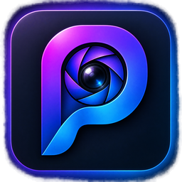
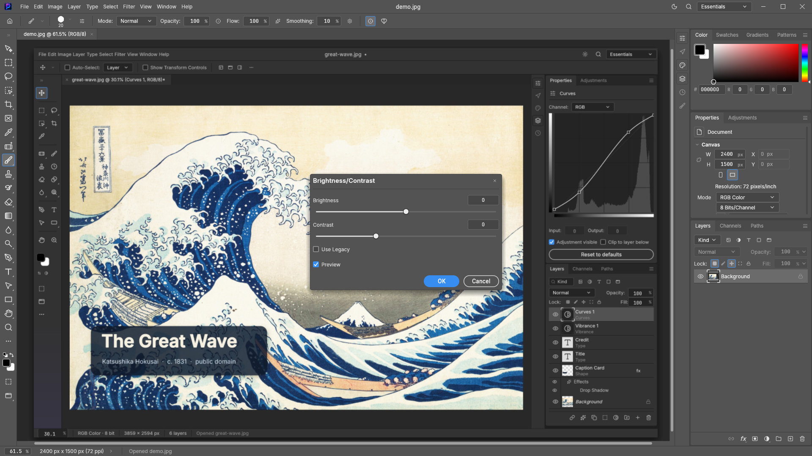
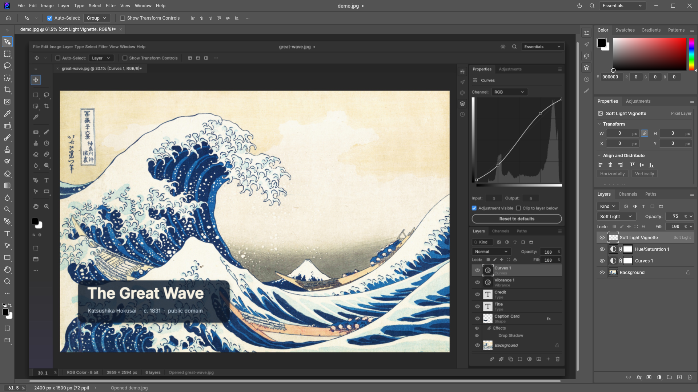
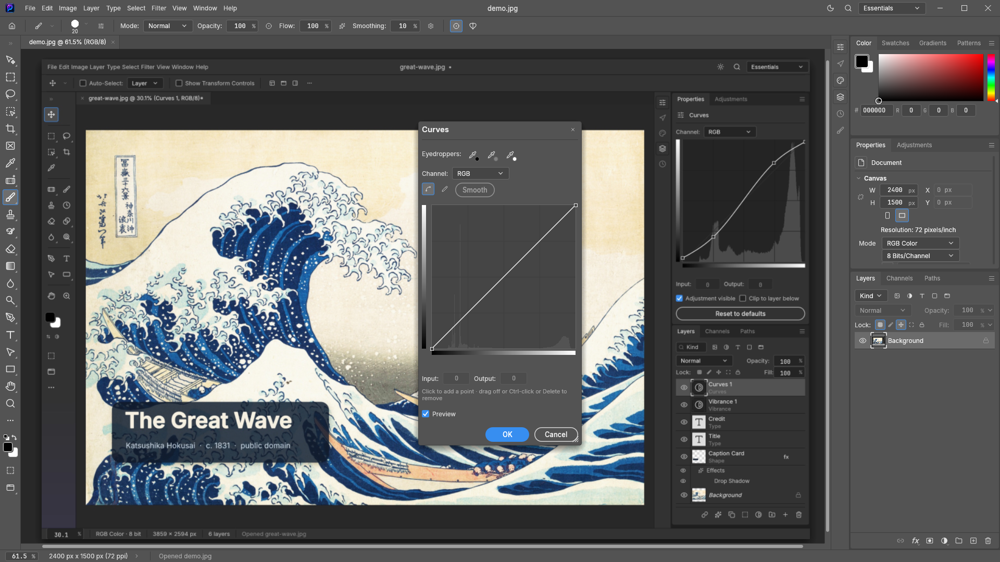
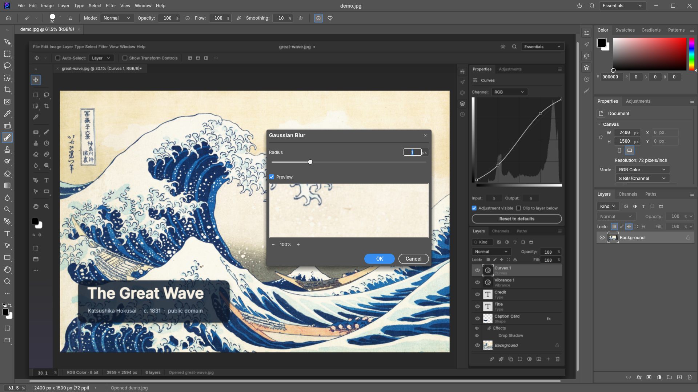
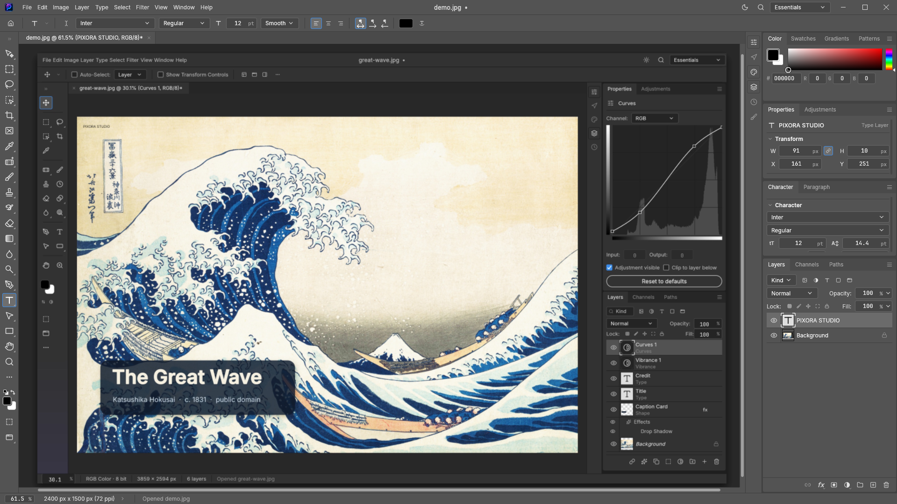
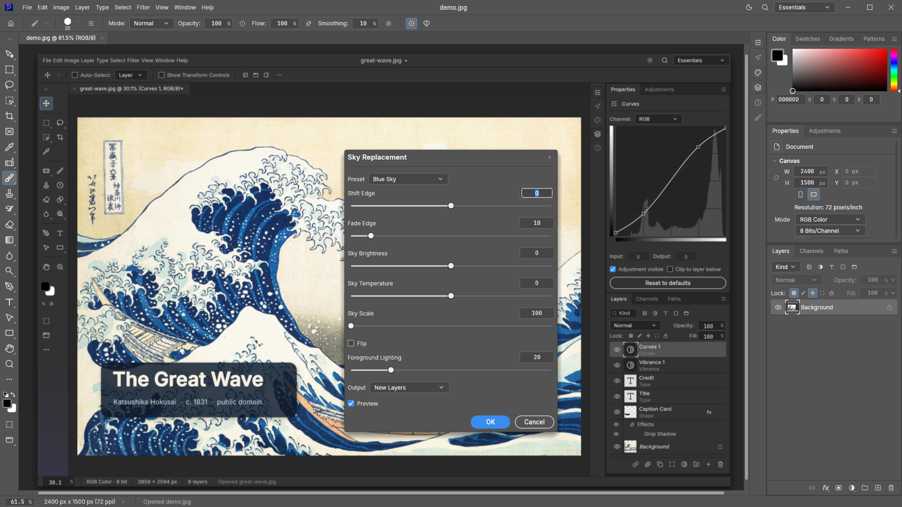
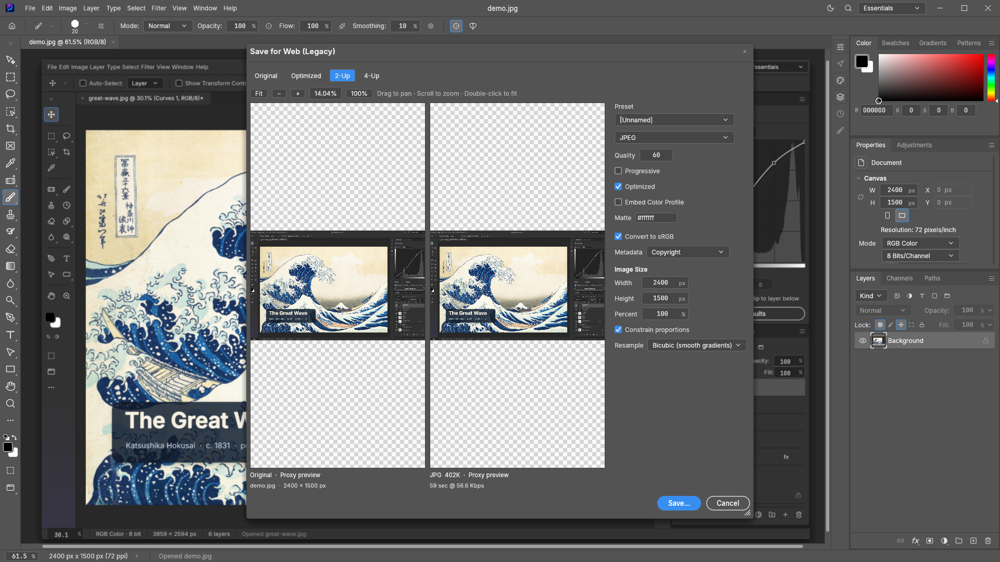

<p align="center">
  
</p>

<p align="center">
  
</p>

<h1 align="center">Pixora Studio</h1>

<p align="center">
  <b>Professional Photo Editing. Free for Everyone.</b><br>
  Published by <b>IT Amadersomaj Inc.</b><br>
  🌐 <b>Official Website:</b> <a href="https://mohammad-sheikh-shahinur-rahman.github.io/Pixora-Studio-Professional-Photo-Editor/">mohammad-sheikh-shahinur-rahman.github.io/Pixora-Studio-Professional-Photo-Editor</a><br>
  Layers, masks, adjustment layers, layer styles, typography, vectors, brushes, and true PSD support,<br>
  in a native desktop application written entirely in Rust. Free, open source, offline, and yours.
</p>

<p align="center">
  <a href="https://apps.microsoft.com/detail/9MT7D275SVMR" target="_blank">
    
  </a>
</p>

<p align="center">
  <a href="https://apps.microsoft.com/detail/9MT7D275SVMR"></a>
  
  
  
  
</p>

<br>

<p align="center">
  <a href="artifacts/screenshots/01-main-workspace.png">
    
  </a>
  <br>
  <sub>Pixora Studio running native hardware-accelerated wgpu composition with dark studio interface, live image adjustments, and dockable panels.</sub>
</p>

<br>

<table>
  <tr>
    <td width="25%" valign="top">
      <h3>🎛️ Familiar by Design</h3>
      Menus, keyboard shortcuts, tools, and dockable panels are right where professional editors expect them. From Ctrl+J to Ctrl+T, your muscle memory works out of the box.
    </td>
    <td width="25%" valign="top">
      <h3>⚡ Native & Lightning Fast</h3>
      Pure Rust with a high-performance GPU compositor on <b>wgpu</b> (DirectX 12 and Vulkan), tile-based multithreading, and copy-on-write memory. Zero Electron, zero webview, zero lag.
    </td>
    <td width="25%" valign="top">
      <h3>🗂️ True PSD Fidelity</h3>
      Open, edit, and save layered Adobe Photoshop documents (PSD/PSB). High-fidelity preservation of layer structures, blend modes, masks, and smart objects.
    </td>
    <td width="25%" valign="top">
      <h3>🔒 100% Offline & Free</h3>
      No subscriptions, no mandatory accounts, no cloud dependencies, and zero telemetry. Pixora Studio runs completely on your machine and belongs to you.
    </td>
  </tr>
</table>

<br>

## Screenshots & Interface Tour

Pixora Studio delivers an uncompromising, responsive desktop experience. Here are authentic captures taken directly from the running application on Windows 11:

<table>
  <tr>
    <td width="50%" valign="top">
      <a href="artifacts/screenshots/01-main-workspace.png">
        
      </a>
      <p align="center"><b>01. Main Dark Workspace</b><br>
      <sub>Full dark studio UI, dockable panels (Layers, Navigator, Color, Properties, History), status bar, and real canvas.</sub></p>
    </td>
    <td width="50%" valign="top">
      <a href="artifacts/screenshots/02-photo-editing.png">
        
      </a>
      <p align="center"><b>02. Photo Adjustments</b><br>
      <sub>Real-time Brightness & Contrast adjustments with interactive tonal sliders and live canvas feedback.</sub></p>
    </td>
  </tr>
  <tr>
    <td width="50%" valign="top">
      <a href="artifacts/screenshots/03-layers-composition.png">
        
      </a>
      <p align="center"><b>03. Non-Destructive Layers</b><br>
      <sub>Adjustment layers (Curves, Hue/Saturation), blend modes (Soft Light, Multiply, Screen), opacity, and layer grouping.</sub></p>
    </td>
    <td width="50%" valign="top">
      <a href="artifacts/screenshots/04-color-correction.png">
        
      </a>
      <p align="center"><b>04. Professional Curves</b><br>
      <sub>Full Curves modal for composite RGB and individual color channels with smooth cubic splines and eyedroppers.</sub></p>
    </td>
  </tr>
  <tr>
    <td width="50%" valign="top">
      <a href="artifacts/screenshots/05-filters-effects.png">
        
      </a>
      <p align="center"><b>05. Filters & Blur Effects</b><br>
      <sub>Multi-threaded Gaussian Blur with pixel-radius controls, real-time preview toggle, and instant GPU execution.</sub></p>
    </td>
    <td width="50%" valign="top">
      <a href="artifacts/screenshots/06-typography-text.png">
        
      </a>
      <p align="center"><b>06. Typography & Type Tool</b><br>
      <sub>Live text rendering on canvas with dedicated Character & Paragraph panels for font family, size, tracking, and leading.</sub></p>
    </td>
  </tr>
  <tr>
    <td width="50%" valign="top">
      <a href="artifacts/screenshots/07-advanced-editing.png">
        
      </a>
      <p align="center"><b>07. Sky Replacement & AI Tools</b><br>
      <sub>Sky Replacement with built-in presets (Blue Sky, Sunset, Dramatic, Night), edge shift, fade, and color harmonization.</sub></p>
    </td>
    <td width="50%" valign="top">
      <a href="artifacts/screenshots/08-export-result.png">
        
      </a>
      <p align="center"><b>08. Export & Web Optimization</b><br>
      <sub>Legacy Save for Web interface with PNG, JPEG, GIF, WebP formats, quality compression, and 2-Up split preview.</sub></p>
    </td>
  </tr>
</table>

<br>

## Key Features

### Professional Image Editing & Layer Stack
- **Full Layer Management:** Raster layers, vector shape layers, type layers, group folders, and adjustment layers.
- **Masking:** Pixel masks, vector clipping paths, clipping masks, and layer style blending options.
- **Non-Destructive Adjustments:** Curves, Levels, Hue/Saturation, Vibrance, Color Balance, Black & White, Threshold, and Invert.
- **Layer Effects (FX):** Drop Shadows, Inner Shadows, Outer Glow, Inner Glow, Bevel & Emboss, Color Overlay, and Stroke.
- **Blending Modes:** 27 industry-standard blend modes matching ISO 32000 specifications (Multiply, Screen, Overlay, Soft Light, Linear Dodge, etc.).

### Precision Tools & Canvas
- **Selection Suite:** Rectangular & Elliptical Marquee, Freehand Lasso, Polygonal Lasso, Magnetic Lasso, Magic Wand, and Quick Selection.
- **Transformation:** Free Transform (Scale, Rotate, Skew, Distort, Perspective) with high-precision bicubic/bilinear interpolation.
- **Retouching & Brushes:** Healing Brush, Clone Stamp, Spot Removal, Eraser, Gradient, Paint Bucket, Blur, Sharpen, and Smudge.
- **Color Management:** High-precision ICC color workflows via photocraft-cms, supporting 8-bit, 16-bit integer, and 32-bit floating point pipelines.

### Supported File Formats
- **Native Project:** `.pix` (Pixora Studio high-speed transactional document format; supports `.pix`, `.pixora`, `.pcraft`)
- **Photoshop:** `.psd`, `.psb` (read and write)
- **Standard Raster:** PNG, JPEG, TIFF, WebP, GIF, BMP, TGA, ICO, QOI
- **High Dynamic Range:** OpenEXR (`.exr`), Radiance HDR (`.hdr`), AVIF (`.avif`)

### Global Localization
Pixora Studio includes comprehensive native localization across 12 languages:
- **English (en-US)** — Base catalog
- **Bengali (বাংলা, bn)** — 100% complete coverage (2,060/2,060 terms translated)
- German, French, Spanish, Italian, Portuguese, Japanese, Korean, Simplified Chinese, Traditional Chinese, Czech

---

## Downloads (Windows 10/11 x64)

Pixora Studio is distributed for 64-bit Windows systems. Binaries link the C runtime statically (`+crt-static`), requiring no external Visual C++ runtime installation.

<p align="center">
  <a href="https://apps.microsoft.com/detail/9MT7D275SVMR" target="_blank">
    
  </a>
</p>

| Package | Description | Link |
|---|---|---|
| **Microsoft Store (Recommended)** | Official Microsoft Store release with automated updates, background security sandboxing, and seamless installation | [Microsoft Store Web](https://apps.microsoft.com/detail/9MT7D275SVMR) · [Open in Store App](ms-windows-store://pdp/?productid=9MT7D275SVMR) |
| **Windows Setup Installer (`.exe`)** | Self-contained single-click executable setup installer | [GitHub Releases](https://github.com/mohammad-sheikh-shahinur-rahman/Pixora-Studio-Professional-Photo-Editor/releases) |
| **Windows MSI Installer (`.msi`)** | Per-machine Windows installer with Start Menu shortcuts and file associations | [GitHub Releases](https://github.com/mohammad-sheikh-shahinur-rahman/Pixora-Studio-Professional-Photo-Editor/releases) |
| **Portable Edition (`.zip`)** | Zero-install standalone archive. Keeps settings in `PixoraStudioData\` beside the executable | [GitHub Releases](https://github.com/mohammad-sheikh-shahinur-rahman/Pixora-Studio-Professional-Photo-Editor/releases) |

---

## Building from Source

### Prerequisites
- **Operating System:** Windows 10/11 (x64)
- **Rust Toolchain:** Stable Rust 1.85+ (`rustup default stable`)
- **C++ Build Tools:** Visual Studio 2022 Build Tools (MSVC with Windows SDK)
- **WiX Toolset (Optional, for MSI and EXE packaging):**
  ```powershell
  dotnet tool install --global wix --version 5.0.2
  wix extension add -g WixToolset.UI.wixext/5.0.2 WixToolset.Util.wixext/5.0.2 WixToolset.BootstrapperApplications.wixext/5.0.2
  ```

### Quick Build
```powershell
# Clone the repository
git clone https://github.com/mohammad-sheikh-shahinur-rahman/Pixora-Studio-Professional-Photo-Editor.git
cd Pixora-Studio-Professional-Photo-Editor

# Build release binaries
cargo build --release -p photocraft -p photocraft-cli
```
The compiled binaries will be generated at:
- `target\release\pixora-studio.exe` (Pixora Studio GUI)
- `target\release\pixora-studio-cli.exe` (Pixora Studio CLI)

### Package Installers and Portable ZIP
```powershell
pwsh packaging/windows/package.ps1 -Arch x64
```
Artifacts are produced in `dist\release\`:
- `pixora-studio-0.15.1-windows-x64-installer.exe`
- `pixora-studio-0.15.1-windows-x64.msi`
- `pixora-studio-0.15.1-windows-x64-portable.zip`

### Package Microsoft Store MSIX
```powershell
python packaging/windows/make_msix.py
```
Output: `dist\release\pixora-studio-0.15.1-windows-x64.msix`

---

## Open-Source License & Credits

Pixora Studio is free software published by **IT Amadersomaj Inc.**

- **License:** Dual-licensed under the **MIT License** ([`LICENSE-MIT`](LICENSE-MIT)) and **Apache License, Version 2.0** ([`LICENSE-APACHE`](LICENSE-APACHE)).
- **Fork Heritage:** Pixora Studio is an independent fork derived from PhotoCraft (created by the ArtCraft Team and open-source contributors). Portions copyright &copy; 2026 ArtCraft Team and PhotoCraft contributors.
- **Trademark Notice:** All original ArtCraft brand assets and logos have been completely removed and replaced with the original Pixora Studio visual identity. Pixora Studio is not affiliated with or endorsed by Adobe Systems Inc. or the original ArtCraft Team.
- For third-party font, icon, and library licenses, see [`LICENSES.md`](LICENSES.md), [`NOTICE`](NOTICE), and [`ATTRIBUTION.md`](ATTRIBUTION.md).
